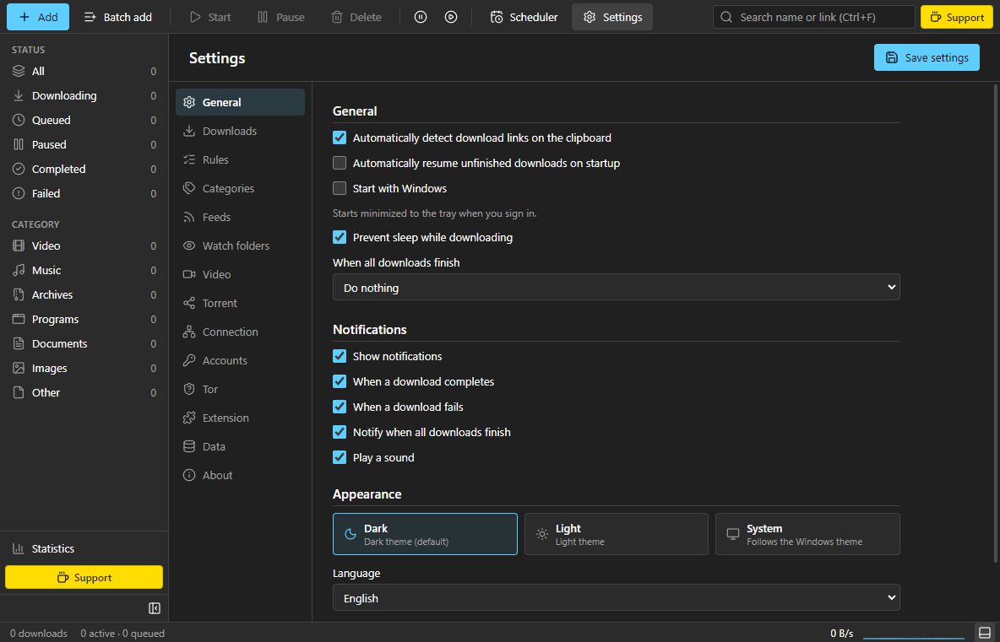

# Lexi Download Manager

Free, local-first multi-part download manager for Windows with video sites, live HLS capture, Debrid, torrents, and bundled browser extensions.

### [Download Lexi Download Manager 0.3.2 for Windows](https://github.com/lexi-apps/lexi-download-manager/releases/latest)

Run <code>Lexi-Setup-0.3.2.exe</code> (installer) or <code>Lexi-Portable-0.3.2.zip</code> (portable) · Windows 10 or Windows 11 (64-bit)

[Overview](#overview) · [Features](#features) · [Screenshots](#screenshots) · [Installation](#installation) · [FAQ](#faq) · [Türkçe](#türkçe)

 

---

## Overview

Lexi Download Manager brings multi-part HTTP/HTTPS downloads, organized queues, video extraction, live HLS stream capture, BitTorrent, Debrid services, and cloud file hosts together in a clean Windows desktop application.

Your download history, encrypted cookies, credentials, Debrid API keys, and extension pairing tokens remain strictly on your own machine. Communication between your browser and Lexi runs locally over `127.0.0.1:19847` with zero accounts, zero advertisements, and zero telemetry.

## Features

| Capability | Details |
|---|---|
| **Multi-part acceleration & queues** | Splits files into parallel connections via `aria2c` with pause/resume, automatic retries, live speed SVG charts, piece bitfield bars, drag-and-drop queue ordering, and multiple custom queues with independent concurrency limits and per-queue start/pause controls. |
| **Video sites & clip trimming** | Downloads from YouTube and 1,000+ video sites (`yt-dlp` + `FFmpeg`) with quality profiles, optional clip trimming (`ss`, `mm:ss`, or `hh:mm:ss` start/end timestamps), SSRF-guarded thumbnail previews, SponsorBlock chapter skipping, metadata embedding, playlist selection, audio-only (`m4a` / `opus`), and subtitles. |
| **Live HLS stream capture** | The browser extension detects live HLS and media streams playing on web pages, lists selectable resolutions in the extension popup, and merges segments cleanly into a single video file. |
| **BitTorrent & magnet links** | Supports magnet URIs and local `.torrent` files, optional Windows default magnet handler registration, selective multi-file `.torrent` file picker, live global upload speed limit (`KB/s`), and configurable post-download seed time/ratio limits. |
| **Debrid & file hosts** | Built-in **Real-Debrid**, **AllDebrid**, and **TorBox** support using write-only encrypted API keys in priority order with automatic direct fallback, plus native resolvers for **Buzzheavier**, **Bzzhr**, **FuckingFast**, **Krakenfiles**, **1Fichier**, Mega (files and folders), Gofile (including password-protected links), Pixeldrain, and MediaFire. |
| **Bundled browser extensions** | Supports Chrome, Edge, Brave, Opera, Vivaldi, and Firefox — both Chromium (`v0.3.2`) and Firefox (`v0.3.2`) extensions ship bundled directly inside the installer and portable package. Eliminates native browser Save-As popups when Lexi is active, includes a 15-minute browser handback bridge, Batch Link Grabber (`Alt+Shift+G`, up to 2,000 links), per-site toggle, `Alt`-click bypass, and expired link refresh. |
| **3-stage download dialog & drop-zone** | Floating **IDM-style 3-stage download dialog** (Save Prompt with live free disk space & recent folder chips -> Live Progress with SVG speed chart, segment bars & inline speed limit -> Completion summary), paired with an always-on-top **Floating Drop-Zone** widget for dragging URLs and `.torrent` files directly. |
| **Automation & organization** | Custom download rules (by extension, domain, or URL pattern -> folder, speed limit, naming template, post-action), custom categories, RSS/Atom feed subscriptions, watched folders (`.torrent` / `.txt`), duplicate download warnings, and Windows taskbar progress indicator. |
| **Power-user interface** | Combine **Status + Category + Queue** filters simultaneously and clear active filter chips above the list, resize the **Details** panel smoothly (height persists across restarts) with an aggregate summary for multi-row selections, search **Settings** live in English or Turkish, set bulk speed limits, and export selected links to `.txt`. |
| **Privacy, encryption & Tor/proxy** | Stores saved cookies, HTTP authentication, proxy credentials, site logins, Debrid keys, and extension pairing token (`X-Lexi-Token`) encrypted on your PC. Supports end-to-end global or per-download HTTP, HTTPS, and SOCKS5/SOCKS5h proxies (direct, Debrid, file hosts, MEGA, HLS, and `yt-dlp`) as well as built-in Tor routing. |
| **Integrity, portable mode & backups** | Expected checksum verification (SHA-256 / MD5), mirror URL fallback, automatic Windows Defender scan, daily automatic database backups (`7` automatic, `20` manual), safe settings export/import, and portable mode via `portable.txt`. |
| **Self-updating & languages** | Background auto-updates for Lexi and its bundled tools via GitHub Releases, full real-time **English** and **Turkish** UI switching, and built-in redacted diagnostic issue reporting. |

## Screenshots

| Save as dialog | Choose video quality | Settings |
|---|---|---|
|  |  |  |

## Installation

- **Desktop Installer:** Download **`Lexi-Setup-0.3.2.exe`** from the [latest release](https://github.com/lexi-apps/lexi-download-manager/releases/latest) and run it. Because the binary is not code-signed yet, Windows SmartScreen may show a prompt — click **More info -> Run anyway**.
- **Portable Archive:** Download **`Lexi-Portable-0.3.2.zip`** and extract it anywhere. Portable mode keeps all databases and settings in its local `data/` folder without writing to `%APPDATA%`.
- **Browser Extension:** Both Chromium and Firefox `0.3.2` extensions are already bundled inside the app. Open Lexi and go to **Settings -> Browser extension** to open the extension folder and follow the guided setup steps.
- **Requirements:** Windows 10 or Windows 11 (64-bit).

## FAQ

<b>Is it really free?</b>

Yes. Every feature in Lexi Download Manager is free, with no advertisements, no user accounts, and no paid tier.

<b>How do updates work?</b>

While running in installed mode, Lexi checks GitHub Releases for newer versions, verifies package integrity, downloads updates in the background, and installs them cleanly when you exit (or when you restart to apply). Portable builds notify you when a new version is available so you can replace the files while keeping your `data/` folder.

<b>Clicking a magnet link opens another program.</b>

Lexi never replaces your existing torrent client automatically. Go to **Settings -> Torrent -> Make default torrent app** and assign Lexi for `magnet` and `.torrent` in Windows Default apps.

<b>How does the browser extension handle my privacy?</b>

All captured URLs, session cookies, and page media links stay on your PC and are transmitted solely to Lexi at `127.0.0.1:19847`. Nothing is ever uploaded to external servers. Read the full [Privacy Policy](PRIVACY.md).

<b>What are the other files in each release?</b>

- `latest.yml` and `.blockmap`: metadata used by the automatic updater.
- `*.tar.xz`, `*.7z`, `lexi-ffmpeg-*-build-recipe.zip`, `SHA256SUMS.txt`: complete source code archives and checksums for the bundled open-source tools (`aria2`, `GMP`, `FFmpeg`, `7-Zip`), published to comply with their respective licenses.

## Support

If Lexi saves you time, you can support ongoing development and code-signing certificate costs via Patreon or Buy Me a Coffee:

## More from Lexi Apps

- **Official Website:** [lexi-apps.pages.dev/lexi-download-manager](https://lexi-apps.pages.dev/lexi-download-manager/)
- **Discord Community:** [discord.gg/HN9eWThUn2](https://discord.gg/HN9eWThUn2)
- **[Lexi Ren'Py Translator](https://github.com/lexi-apps/lexi-renpy-translator):** Translation tool for Ren'Py visual novels with automatic backups and glossary support.
- **[LexiDictate](https://github.com/lexi-apps/lexi-dictate):** Sub-second system-wide voice dictation for Windows powered by Gemini Live and Flash.

## License

Lexi Download Manager is free to use (freeware). Lexi's own application source code is proprietary and is not published in this release repository. Bundled open-source components retain their respective licenses; see **Settings -> About -> License and third-party notices** in the app or review the published source archives on the Releases page.

## Contact

Bug reports and questions: **lexiapps@protonmail.com** — or use **Settings -> About -> Report a problem** inside the app.

---

## Türkçe

Windows 10 ve 11 (64-bit) için ücretsiz, reklam içermeyen ve tam yerel çalışan indirme yöneticisi: paralel çok parçalı hızlandırma, çoklu indirme sıraları, klip kesmeli video indirme, canlı HLS yayın yakalama, Debrid servisleri, torrent ve gömülü tarayıcı eklentileri.

**[En Son Sürümü İndir (v0.3.2)](https://github.com/lexi-apps/lexi-download-manager/releases/latest)** · **[Resmi Web Sitesi](https://lexi-apps.pages.dev/lexi-download-manager/)** · **[Discord Topluluğu](https://discord.gg/HN9eWThUn2)**

### Öne Çıkan Özellikler

| Özellik | Ayrıntılar |
|---|---|
| **Çok parçalı indirme ve sıralar** | Dosyaları `aria2c` ile paralel parçalara bölerek hızlandırır. Duraklat/devam ettir, otomatik yeniden deneme, canlı hız grafiği, parça çubukları, sürükle-bırak öncelik ve bağımsız eşzamanlılık/duraklatma sunan çoklu indirme sıraları içerir. |
| **Video siteleri ve klip kesme** | YouTube ve 1.000+ siteden kalite profilleri, başlangıç/bitiş zamanıyla klip kesme (`sn`, `dd:sn`, `ss:dd:sn`), güvenli küçük resim önizlemesi, SponsorBlock, bölüm/meta veri gömme, oynatma listesi seçimi, yalnız ses ve altyazı desteğiyle indirir. |
| **Canlı HLS yayın yakalama** | Tarayıcı eklentisi sayfada oynatılan canlı HLS yayınlarını algılar, çözünürlükleri listeler ve segmentleri tek bir video dosyası olarak birleştirir. |
| **Torrent ve magnet bağlantıları** | Magnet bağlantıları ve `.torrent` dosyalarını destekler. Çok dosyalı torrentlerde seçici dosya indirme penceresi, canlı genel yükleme hızı sınırı (`KB/sn`) ve ayarlanabilir paylaşım sınırı sunar. |
| **Debrid ve dosya siteleri** | Şifreli ve gizli tutulan API anahtarlarıyla öncelik sırasına göre çalışan **Real-Debrid**, **AllDebrid** ve **TorBox** desteği; ayrıca **Buzzheavier**, **Bzzhr**, **FuckingFast**, **Krakenfiles**, **1Fichier**, Mega, Gofile (parolalı bağlantılar dahil), Pixeldrain ve MediaFire çözücüleri. |
| **Gömülü tarayıcı eklentileri** | Chrome, Edge, Brave, Opera, Vivaldi ve Firefox desteklenir; hem Chromium hem Firefox `0.3.2` eklentileri kurulum ve taşınabilir paketin içinde hazır gelir. Lexi etkinken yerel tarayıcı Save-As penceresi açılmaz; 15 dakikalık tarayıcıya geri devir köprüsü, Toplu Bağlantı Toplayıcı (`Alt+Shift+G`), eşleştirme kodu ve süresi dolan bağlantıyı yenileme içerir. |
| **3 aşamalı pencere ve kayan sepet** | Kayan **IDM tarzı 3 aşamalı indirme penceresi** (canlı boş disk alanı ve hızlı klasörler -> SVG hız grafiği, segment çubukları ve satır içi hız limitiyle canlı ilerleme -> Tamamlandı özeti) ile doğrudan URL ve `.torrent` sürüklenebilen her zaman üstte **Kayan Bırakma Sepeti** sunar. |
| **Gelişmiş arayüz ve otomasyon** | Birleşik **Durum + Kategori + Sıra** filtreleme, yüksekliği hatırlanan ve çoklu seçim özeti gösteren **Ayrıntılar** paneli, Türkçe/İngilizce **Ayarlar araması**, toplu hız sınırı, `.txt` bağlantı dışa aktarma, özel indirme kuralları, RSS/Atom akışları ve izlenen klasörler. |
| **Gizlilik, Tor/vekil ve yedekleme** | Hesap, reklam veya telemetri içermez; kayıtlı çerezler, vekil şifreleri, site hesapları ve Debrid anahtarları bilgisayarınızda şifreli tutulur. Genel/görev bazlı uçtan uca HTTP, HTTPS ve SOCKS5/SOCKS5h vekil desteği, yerleşik Tor yönlendirmesi, SHA-256/MD5 doğrulaması, Windows Defender taraması ve günlük otomatik yedekler sunar. |

### Kurulum

- **Kurulum Paketi:** [En son sürümden](https://github.com/lexi-apps/lexi-download-manager/releases/latest) **`Lexi-Setup-0.3.2.exe`** dosyasını indirip çalıştırın. Dijital imza sertifikası henüz bulunmadığı için Windows SmartScreen uyarısı çıkarsa **Ek bilgi -> Yine de çalıştır** seçin.
- **Taşınabilir Sürüm:** Kurulum gerektirmeden kullanmak için **`Lexi-Portable-0.3.2.zip`** arşivini çıkartın; tüm veriler program yanındaki `data/` klasöründe saklanır.
- **Tarayıcı Eklentisi:** Hem Chromium hem Firefox `0.3.2` eklentileri programla birlikte gelir. **Ayarlar -> Tarayıcı eklentisi** üzerinden eklenti klasörünü açıp adım adım kurulum sihirbazını izleyebilirsiniz.
- **Gereksinim:** Windows 10 veya Windows 11 (64-bit).

### Sık Sorulan Sorular

<b>Gerçekten ücretsiz mi?</b>

Evet. Lexi Download Manager'daki tüm özellikler ücretsizdir; reklam, kullanıcı hesabı zorunluluğu veya ücretli sürüm bulunmaz.

<b>Güncellemeler nasıl çalışır?</b>

Kurulu sürüm çalışırken yeni sürümleri arka planda kontrol eder, doğrulayarak indirir ve uygulamayı kapattığınızda kurar. Taşınabilir sürüm ise yeni sürüm çıktığında bildirim gösterir; eski `data/` klasörünüzü koruyarak güncelleme yapabilirsiniz.

<b>Magnet bağlantısına tıklayınca başka program açılıyor.</b>

Lexi mevcut torrent programınızın yerini kendiliğinden almaz. **Ayarlar -> Torrent -> Varsayılan torrent programı yap** düğmesini kullanıp Windows Varsayılan uygulamalar ayarlarından `magnet` ve `.torrent` için Lexi'yi seçebilirsiniz.

<b>Sürümdeki diğer dosyalar ne işe yarar?</b>

`latest.yml` ve `.blockmap` dosyaları otomatik güncelleyici içindir. `*.tar.xz`, `*.7z`, `lexi-ffmpeg-*-build-recipe.zip` ve `SHA256SUMS.txt` ise programla birlikte gelen açık kaynaklı araçların (`aria2`, `GMP`, `FFmpeg`, `7-Zip`) lisansları gereği yayımlanan kaynak kodları ve doğrulama özetleridir.

### Destek, Lisans ve İletişim

Lexi Download Manager ücretsizdir ve reklam içermez. Geliştirme sürecine destek olmak isterseniz [Patreon](https://www.patreon.com/cw/LexiApps) veya [Buy Me a Coffee](https://buymeacoffee.com/lexiapps) üzerinden katkıda bulunabilirsiniz.

- **Discord:** [discord.gg/HN9eWThUn2](https://discord.gg/HN9eWThUn2)
- **Hata bildirimi ve sorular:** **lexiapps@protonmail.com** (veya uygulama içinde **Ayarlar -> Hakkında -> Sorun bildir**)
- **Lisans:** Uygulama ücretsiz yazılımdır (freeware); açık kaynaklı bileşenlerin lisansları **Ayarlar -> Hakkında -> Lisans ve üçüncü taraf bildirimleri** bölümündedir.

&copy; Lexi Apps

