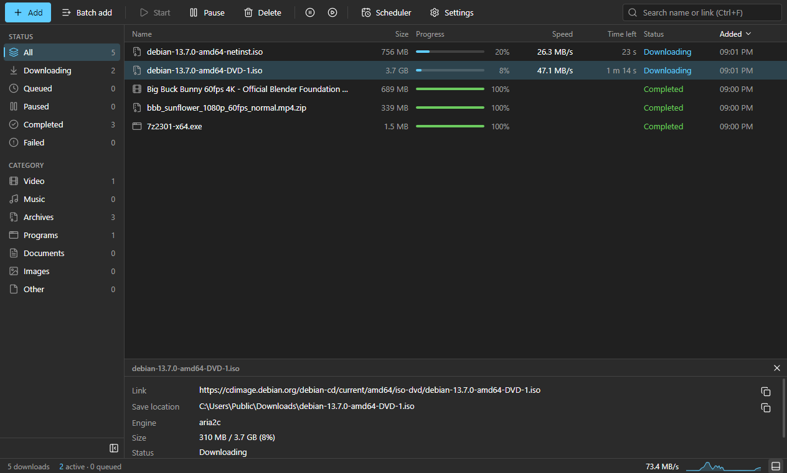
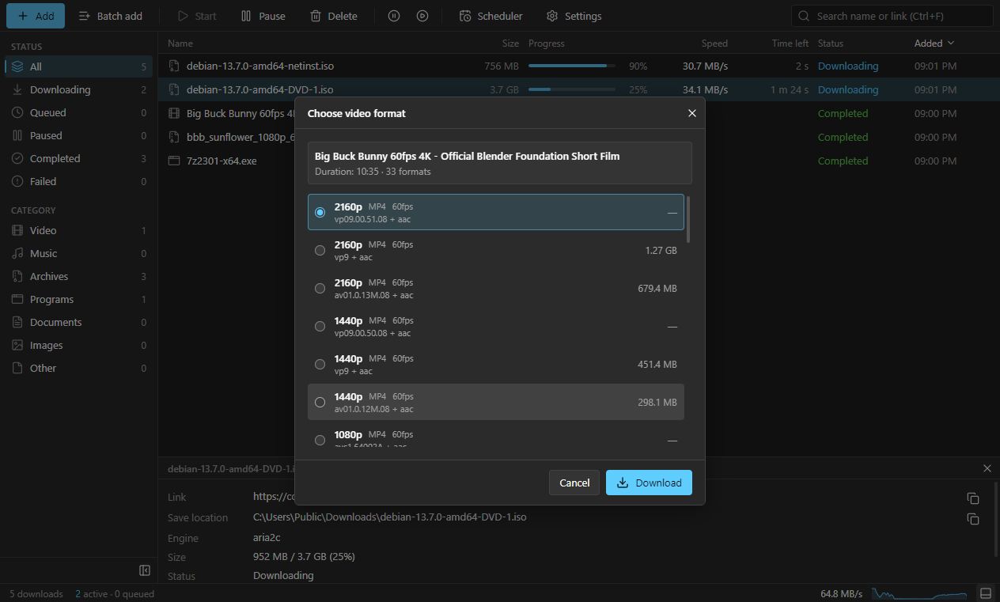
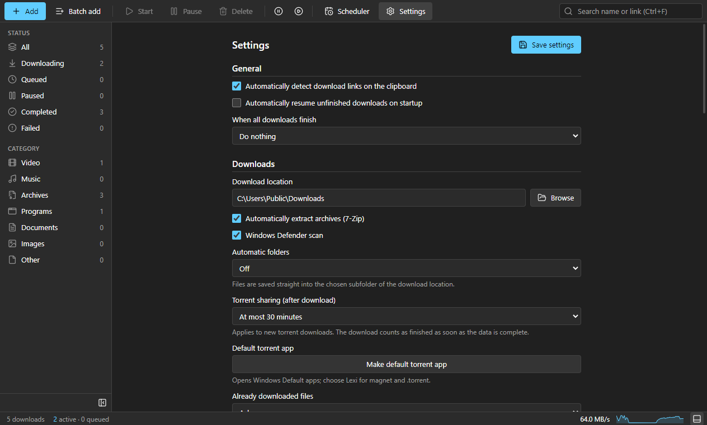

# Lexi Download Manager

**A free download manager for Windows: fast multi-part downloads, video sites, torrents and a browser extension.**

-0078d4)

### [⬇ Download the latest version](https://github.com/lexi-apps/lexi-download-manager/releases/latest)

Run <code>Lexi-Setup-x.y.z.exe</code> from the latest release. You don't need the other files.

[English](#features) · [Türkçe](#türkçe)

 

---

## Features

| | |
|---|---|
| ⚡ **Fast downloads** | Splits each file into parts and downloads them in parallel. Pause, resume and automatic retries. |
| 🎬 **Video sites** | Downloads videos from YouTube and many other sites. Choose quality, subtitles included. |
| 📺 **Stream capture** | The extension detects videos playing on a page (HLS streams) and saves them as a single file. |
| 🧲 **Torrents** | Magnet links and .torrent files. Opens magnet links from your browser. Sharing after the download can be limited or turned off. |
| ☁️ **File hosts** | Mega and Gofile links. |
| 🧩 **Browser extension** | Chrome, Edge, Brave, Opera, Vivaldi and Firefox. Downloads are sent to Lexi automatically. |
| 📁 **Organised** | Sorts finished files into folders by type, warns about duplicates, scans finished files with Windows Defender. |
| 🔒 **Privacy** | No account, no ads, no tracking. Saved cookies and passwords are encrypted on your PC. Optional Tor support. |
| 🔄 **Always up to date** | The app and its download tools update themselves. |
| 🌍 **Languages** | English and Turkish. |

## Screenshots

| Choose video quality | Settings |
|---|---|
|  |  |

## Installation

1. Download **`Lexi-Setup-x.y.z.exe`** from the [latest release](https://github.com/lexi-apps/lexi-download-manager/releases/latest).
2. Run it. The installer is not code-signed yet, so Windows SmartScreen may warn you: choose **More info → Run anyway**.
3. To add the browser extension, open Lexi and go to **Settings → Browser extension → Install extension**. A short wizard walks you through it.

**Requirements:** Windows 10 or Windows 11, 64-bit.

## FAQ

<b>Is it really free?</b>

Yes. No ads, no account, no paid version.

<b>How do updates work?</b>

While Lexi is running it checks this page for new versions, downloads them in the background and installs them when you close the app.

<b>Clicking a magnet link opens another program.</b>

Lexi never replaces your existing torrent client on its own. Go to **Settings → Make default torrent app** and choose Lexi for "magnet" and ".torrent" in Windows Default apps.

<b>What are the other files in each release?</b>

- `latest.yml` and `.blockmap`: used by the automatic updater.
- `*.tar.xz`, `*.7z`, `lexi-ffmpeg-*-build-recipe.zip`, `SHA256SUMS.txt`: source code of the bundled open-source tools (aria2, GMP, FFmpeg, 7-Zip). They are published to comply with their licenses.

## Support Lexi

Lexi is free and has no ads. If it saves you time, you can support its development on Patreon:

## License

Lexi Download Manager is free to use (freeware). Lexi's own source code is not published in this repository. The bundled open-source tools keep their own licenses: see **Settings → About → License and third-party notices** in the app.

## Contact

Bug reports and questions: **lexiapps@protonmail.com**

---

## Türkçe

**Windows için ücretsiz indirme yöneticisi: hızlı çok parçalı indirme, video siteleri, torrent ve tarayıcı eklentisi.**

### [⬇ En son sürümü indir](https://github.com/lexi-apps/lexi-download-manager/releases/latest)

### Özellikler
- ⚡ **Hızlı indirme:** dosyayı parçalara bölüp aynı anda indirir. Duraklat, devam ettir, otomatik yeniden dene.
- 🎬 **Video siteleri:** YouTube ve birçok siteden video indirir. Kalite seçimi ve altyazı.
- 📺 **Yayın yakalama:** eklenti sayfada oynayan videoyu (HLS) algılar ve tek dosya olarak kaydeder.
- 🧲 **Torrent:** magnet bağlantıları ve .torrent dosyaları. Tarayıcıdaki magnet bağlantıları Lexi'de açılır. İndirme sonrası paylaşım sınırlanabilir ya da kapatılabilir.
- ☁️ **Dosya siteleri:** Mega ve Gofile bağlantıları.
- 🧩 **Tarayıcı eklentisi:** Chrome, Edge, Brave, Opera, Vivaldi ve Firefox. İndirmeler kendiliğinden Lexi'ye gelir.
- 📁 **Düzen:** biten dosyaları türüne göre klasörlere ayırır, aynı dosyayı tekrar indirirken uyarır, biten dosyaları Windows Defender ile tarar.
- 🔒 **Gizlilik:** hesap yok, reklam yok, takip yok. Kayıtlı çerez ve şifreler bilgisayarınızda şifreli saklanır. İsteğe bağlı Tor desteği.
- 🔄 **Hep güncel:** program ve indirme araçları kendini günceller.
- 🌍 **Diller:** Türkçe ve İngilizce.

### Kurulum
1. [En son sürümden](https://github.com/lexi-apps/lexi-download-manager/releases/latest) **`Lexi-Setup-x.y.z.exe`** dosyasını indirin.
2. Çalıştırın. Kurulum dosyası henüz dijital olarak imzalı değil; Windows uyarı verirse **Ek bilgi → Yine de çalıştır** seçin.
3. Tarayıcı eklentisi için Lexi'de **Ayarlar → Tarayıcı eklentisi → Eklentiyi kur** yolunu izleyin; kısa bir sihirbaz adım adım gösterir.

**Gereksinim:** Windows 10 veya Windows 11, 64-bit.

### Sık sorulanlar
- **Gerçekten ücretsiz mi?** Evet. Reklam, hesap ya da ücretli sürüm yok.
- **Güncellemeler nasıl gelir?** Lexi açıkken yeni sürümü arka planda indirir, programı kapatınca kurar.
- **Magnet bağlantısı başka programda açılıyor.** Lexi kurulu torrent programınızın yerini kendiliğinden almaz. **Ayarlar → Varsayılan torrent programı yap** ile Windows'un Varsayılan uygulamalar sayfasında Lexi'yi seçin.
- **Sürümdeki diğer dosyalar ne?** `latest.yml` ve `.blockmap` otomatik güncelleme içindir. `*.tar.xz`, `*.7z`, derleme tarifi ve `SHA256SUMS.txt`, programla gelen açık kaynaklı araçların (aria2, GMP, FFmpeg, 7-Zip) kaynak kodlarıdır; lisansları gereği yayımlanır.

### Destek ol
Lexi ücretsizdir ve reklam içermez. İşinize yarıyorsa geliştirilmesine [Patreon üzerinden destek olabilirsiniz](https://www.patreon.com/cw/LexiApps).

### Lisans ve iletişim
Lexi Download Manager ücretsiz kullanılır. Lexi'nin kendi kaynak kodu bu depoda yayımlanmaz. Programla gelen açık kaynaklı araçların lisansları programdaki **Ayarlar → Hakkında → Lisans ve üçüncü taraf bildirimleri** bölümündedir.

Hata bildirimi ve sorular: **lexiapps@protonmail.com**

© Lexi Apps

