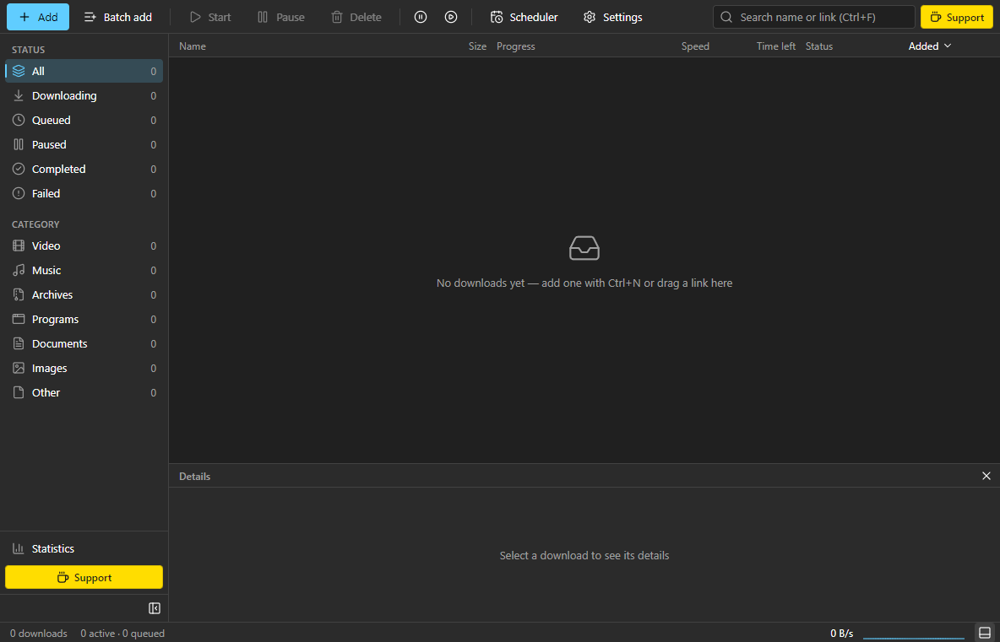
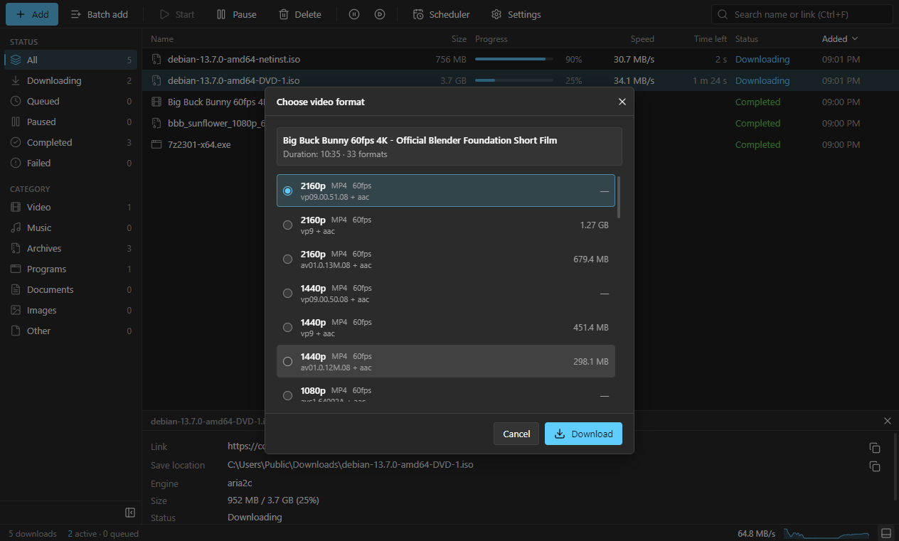
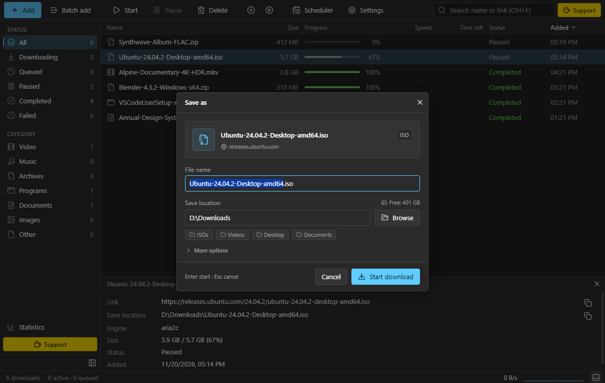

# Lexi Download Manager

**A free download manager for Windows: fast multi-part downloads, video sites, torrents and a browser extension.**

-0078d4)

### [⬇ Download the latest version](https://github.com/lexi-apps/lexi-download-manager/releases/latest) · [🌐 Official Website](https://lexi-apps.pages.dev/lexi-download-manager/)

Run <code>Lexi-Setup-x.y.z.exe</code> from the latest release. You don't need the other files.

[English](#features) · [Türkçe](#türkçe)

 

---

## Features

| | |
|---|---|
| ⚡ **Fast downloads** | Splits each file into parts via aria2c. Multiple queues with independent concurrency limits, combined filters, floating desktop drop-zone widget, drag-and-drop queue priority, live speed/piece graph, resizable multi-select details summary, settings search, bulk speed limit, link export (.txt) and automatic retries. |
| 🎬 **Video sites** | Downloads videos from YouTube and many other sites. Quality profiles, video clip trimming (`start–end` timestamps), safe thumbnail previews, SponsorBlock, chapter/metadata embedding, audio-only and subtitles. |
| 📺 **Stream capture** | The extension detects videos playing on a page (HLS streams) and saves them as a single file. |
| 🧲 **Torrents** | Magnet links and .torrent files with selective multi-file picker and live upload speed limit. Opens magnet links from your browser. Sharing after the download can be limited or turned off. |
| ☁️ **File hosts & Debrid** | **Real-Debrid**, **AllDebrid**, and **TorBox** (encrypted write-only API keys) plus built-in resolvers for **Buzzheavier**, **Bzzhr**, **FuckingFast**, **Krakenfiles**, **1Fichier**, Mega, Gofile, Pixeldrain and MediaFire. |
| 🧩 **Browser extension** | Chrome, Edge, Brave, Opera, Vivaldi and Firefox (both Chromium and Firefox extensions come bundled inside the installer and portable ZIP). Link grabber, confirmation prompt, pairing code and link refresh. |
| 📁 **Organised** | Optional "Save as" dialog, custom download rules, custom categories, RSS/Atom feeds, watched folders, duplicate warnings and Windows Defender scan. |
| 🔒 **Privacy** | No account, no ads, no tracking. Saved cookies, proxy credentials and site passwords are encrypted on your PC. Optional Tor & proxy support. |
| 💼 **Portable & Backups** | Available as both installer and portable ZIP; automatic daily backups and export/import. |
| 🔄 **Always up to date** | The app and its download tools update themselves. |
| 🌍 **Languages** | English and Turkish. |

## Screenshots

| Choose video quality | Save as dialog | Settings |
|---|---|---|
|  |  |  |

## Installation

1. Download **`Lexi-Setup-x.y.z.exe`** from the [latest release](https://github.com/lexi-apps/lexi-download-manager/releases/latest).
2. Run it. The installer is not code-signed yet, so Windows SmartScreen may warn you: choose **More info → Run anyway**.
3. To add the browser extension, open Lexi and go to **Settings → Browser extension** (both Chromium and Firefox extensions come bundled inside the app, and a short wizard walks you through loading them).

**Requirements:** Windows 10 or Windows 11, 64-bit.

## FAQ

<b>Is it really free?</b>

Yes. No ads, no account, no paid version.

<b>How do updates work?</b>

While Lexi is running it checks this page for new versions, downloads them in the background and installs them when you close the app.

<b>Clicking a magnet link opens another program.</b>

Lexi never replaces your existing torrent client on its own. Go to **Settings → Make default torrent app** and choose Lexi for "magnet" and ".torrent" in Windows Default apps.

<b>What are the other files in each release?</b>

- `latest.yml` and `.blockmap`: used by the automatic updater.
- `*.tar.xz`, `*.7z`, `lexi-ffmpeg-*-build-recipe.zip`, `SHA256SUMS.txt`: source code of the bundled open-source tools (aria2, GMP, FFmpeg, 7-Zip). They are published to comply with their licenses.

## Support Lexi

Lexi is free and has no ads. If it saves you time, you can support its development via Buy Me a Coffee or Patreon:

## License

Lexi Download Manager is free to use (freeware). Lexi's own source code is not published in this repository. The bundled open-source tools keep their own licenses: see **Settings → About → License and third-party notices** in the app.

## Contact

Discord community & support: **[discord.gg/HN9eWThUn2](https://discord.gg/HN9eWThUn2)**  
Bug reports and questions: **lexiapps@protonmail.com**

---

## Türkçe

**Windows için ücretsiz indirme yöneticisi: hızlı çok parçalı indirme, video siteleri, torrent ve tarayıcı eklentisi.**

### [⬇ En son sürümü indir](https://github.com/lexi-apps/lexi-download-manager/releases/latest)

### Özellikler
- ⚡ **Hızlı indirme:** dosyayı aria2c ile paralel parçalara böler. Bağımsız eşzamanlılıklı çoklu indirme sıraları, birleşik filtreler, kayan masaüstü bırakma sepeti, sürükle-bırak sıra önceliği, canlı hız/parça grafiği, boyutlandırılabilir çoklu seçim ayrıntı özeti, Ayarlar araması, toplu hız sınırı, `.txt` bağlantı dışa aktarma ve otomatik yeniden dene.
- 🎬 **Video siteleri:** YouTube ve birçok siteden video indirir. Kalite profilleri, video klip kesme (`başlangıç–bitiş` zamanları), güvenli küçük resim önizlemesi, SponsorBlock, bölüm/meta veri gömme, yalnız ses ve altyazı.
- 📺 **Yayın yakalama:** eklenti sayfada oynayan videoyu (HLS) algılar ve tek dosya olarak kaydeder.
- 🧲 **Torrent:** magnet bağlantıları ve `.torrent` dosyaları; seçici çoklu dosya penceresi ve canlı yükleme hızı sınırı. Tarayıcıdaki magnet bağlantıları Lexi'de açılır. İndirme sonrası paylaşım sınırlanabilir ya da kapatılabilir.
- ☁️ **Dosya siteleri ve Debrid:** **Real-Debrid**, **AllDebrid** ve **TorBox** desteği (şifreli ve gizli API anahtarları) ile **Buzzheavier**, **Bzzhr**, **FuckingFast**, **Krakenfiles**, **1Fichier**, Mega, Gofile, Pixeldrain ve MediaFire bağlantıları.
- 🧩 **Tarayıcı eklentisi:** Chrome, Edge, Brave, Opera, Vivaldi ve Firefox (hem Chromium hem Firefox eklentileri kurulum ve taşınabilir paketin içinde hazır gelir). Bağlantı toplayıcı, onay penceresi, eşleştirme kodu ve bağlantı yenileme.
- 📁 **Düzen:** isteğe bağlı "Farklı kaydet" penceresi, özel kurallar, özel kategoriler, RSS/Atom akışları, izlenen klasörler, kopya uyarısı ve Windows Defender taraması.
- 🔒 **Gizlilik:** hesap yok, reklam yok, takip yok. Kayıtlı çerez, vekil kimlik bilgisi ve site şifreleri bilgisayarınızda şifreli saklanır. İsteğe bağlı Tor ve vekil desteği.
- 💼 **Taşınabilir ve yedekli:** hem kurulum hem taşınabilir ZIP sürümü; günlük otomatik yedekler ve dışa/içe aktarma.
- 🔄 **Hep güncel:** program ve indirme araçları kendini günceller.
- 🌍 **Diller:** Türkçe ve İngilizce.

### Kurulum
1. [En son sürümden](https://github.com/lexi-apps/lexi-download-manager/releases/latest) **`Lexi-Setup-x.y.z.exe`** dosyasını indirin.
2. Çalıştırın. Kurulum dosyası henüz dijital olarak imzalı değil; Windows uyarı verirse **Ek bilgi → Yine de çalıştır** seçin.
3. Tarayıcı eklentisi için Lexi'de **Ayarlar → Tarayıcı eklentisi** yolunu izleyin; hem Chromium hem Firefox eklentileri programla birlikte gelir ve kısa bir sihirbaz kurulumu adım adım gösterir.

**Gereksinim:** Windows 10 veya Windows 11, 64-bit.

### Sık sorulanlar
- **Gerçekten ücretsiz mi?** Evet. Reklam, hesap ya da ücretli sürüm yok.
- **Güncellemeler nasıl gelir?** Lexi açıkken yeni sürümü arka planda indirir, programı kapatınca kurar.
- **Magnet bağlantısı başka programda açılıyor.** Lexi kurulu torrent programınızın yerini kendiliğinden almaz. **Ayarlar → Varsayılan torrent programı yap** ile Windows'un Varsayılan uygulamalar sayfasında Lexi'yi seçin.
- **Sürümdeki diğer dosyalar ne?** `latest.yml` ve `.blockmap` otomatik güncelleme içindir. `*.tar.xz`, `*.7z`, derleme tarifi ve `SHA256SUMS.txt`, programla gelen açık kaynaklı araçların (aria2, GMP, FFmpeg, 7-Zip) kaynak kodlarıdır; lisansları gereği yayımlanır.

### Destek ol
Lexi ücretsizdir ve reklam içermez. İşinize yarıyorsa geliştirilmesine [Buy Me a Coffee üzerinden](https://buymeacoffee.com/lexiapps) veya [Patreon üzerinden](https://www.patreon.com/cw/LexiApps) destek olabilirsiniz.

### Lisans ve iletişim
Lexi Download Manager ücretsiz kullanılır. Lexi'nin kendi kaynak kodu bu depoda yayımlanmaz. Programla gelen açık kaynaklı araçların lisansları programdaki **Ayarlar → Hakkında → Lisans ve üçüncü taraf bildirimleri** bölümündedir.

Discord topluluğu ve destek: **[discord.gg/HN9eWThUn2](https://discord.gg/HN9eWThUn2)**  
Hata bildirimi ve sorular: **lexiapps@protonmail.com**

© Lexi Apps

